# Data model (section 6) — ER diagram and table notes

Source of truth: `supabase/migrations/`. Timestamps stored UTC, shown IST. Restricted (finance) tables are marked 🔒 — readable only when `app.can_view_financials()` (Owner always; roles in `settings.finance_roles`; per-user override).

```mermaid
erDiagram
  people ||--o| users : "login (optional)"
  people ||--o| people_contacts : "🔒 Manager-only contact"
  people ||--o{ items : "owner_person_id"
  people ||--o{ items : "holder_person_id (Single)"
  locations ||--o{ items : "holder / home location"
  items ||--o{ items : "parent_item_id / case_item_id"
  items ||--o| item_financials : "🔒 purchase details"
  items ||--o| item_import_raw : "🔒 sheet row + raw values"
  items ||--o{ item_holdings : "Counted: qty per holder & status"
  items ||--o{ photos : "Stock / Latest / Check-out / Check-in / Damage / Invoice🔒 / Audit"
  items ||--o{ missing_parts : ""
  items ||--o{ detached_accessories : ""
  items ||--o{ retirement_requests : ""
  kits ||--o{ kit_items : "contents (qty, required)"
  items ||--o{ kit_items : ""
  loans ||--o{ loan_lines : "one per item (kit = many)"
  items ||--o{ loan_lines : ""
  people ||--o{ loans : "borrower"
  loans ||--o{ loan_events : "chain of custody"
  loans ||--o{ loan_extensions : ""
  loans ||--o| loans : "transferred_from / to"
  items ||--o{ reservations : ""
  kits ||--o{ reservations : ""
  items ||--o{ maintenance_events : ""
  maintenance_events ||--o| maintenance_costs : "🔒"
  maintenance_events ||--o{ maintenance_state_history : ""
  items ||--o{ maintenance_schedules : "or per Type"
  items ||--o{ incidents : "Damage / Loss / Theft / Found"
  loans ||--o{ incidents : "linked_loan_id"
  wishlist_items ||--o{ wishlist_related_items : ""
  items ||--o{ wishlist_related_items : ""
  wishlist_items ||--o| wishlist_financials : "🔒"
  wishlist_items ||--o{ wishlist_options : "🔒 vendor prices"
  orders ||--o| order_financials : "🔒 amount, invoice"
  orders ||--o{ order_lines : ""
  wishlist_items ||--o{ order_lines : ""
  order_lines ||--o{ order_line_items : "items created on receipt"
  audits ||--o{ audit_lines : "walkthrough scans"
  items ||--o{ audit_lines : ""
  import_runs ||--o{ import_row_results : "per-row warnings"
```

Other tables: `settings`, `item_types`, `item_subtypes`, `conditions` (controlled values), `id_counters` (never-reused IDs), `audit_log` (append-only), `notifications_log` (delivery + idempotency), `import_mapping_rules`, `unsorted_items`, `saved_views`, `sync_conflicts`, `mirror_runs`, `job_runs`.

## Invariants enforced in the database (A5)

| Rule | Mechanism |
|---|---|
| One active holder per Single unit (G-01, FR-CHK-006) | partial unique index `loan_lines_single_active` |
| Counted holdings add up to stock (6.6) | deferred constraint triggers `holdings_sum`, `items_holdings_sum` |
| Item IDs immutable, never reused (FR-CAT-001) | `items_bu` trigger, `id_counters` |
| Status/holder/stock change only through workflows | `items_bu` guard (`current_user` = `authenticated` is blocked) |
| No overlapping reservations (FR-CHK-012) | `EXCLUDE USING gist` |
| Approvals only by the Owner (FR-BUY-005) | `wishlist_guard` + `app.decide_wishlist` |
| Audit log append-only (NFR-015) | no grants + triggers raising on UPDATE/DELETE/TRUNCATE |
| Due after check-out; back-dating needs a reason | CHECK constraints on `loans` |
| Logins only @madtown.in (NFR-003) | CHECK on `users.login_email` |

## Workflow functions (`app.*`, SECURITY DEFINER with explicit role checks)

`create_item, checkout, checkin, transfer_loan, extend_loan, mark_loan_lost, report_incident, mark_found, resolve_incident, decide_writeoff, open_maintenance, advance_maintenance, request_retirement, decide_retirement, delete_item_created_in_error, adjust_stock, set_custodian, decide_wishlist, verify_wishlist, receive_order, record_audit_line, apply_audit_correction, split_counted, promote_latest_photo, set_stock_image, deactivate_user, item_audit, job_mark_overdue`.
